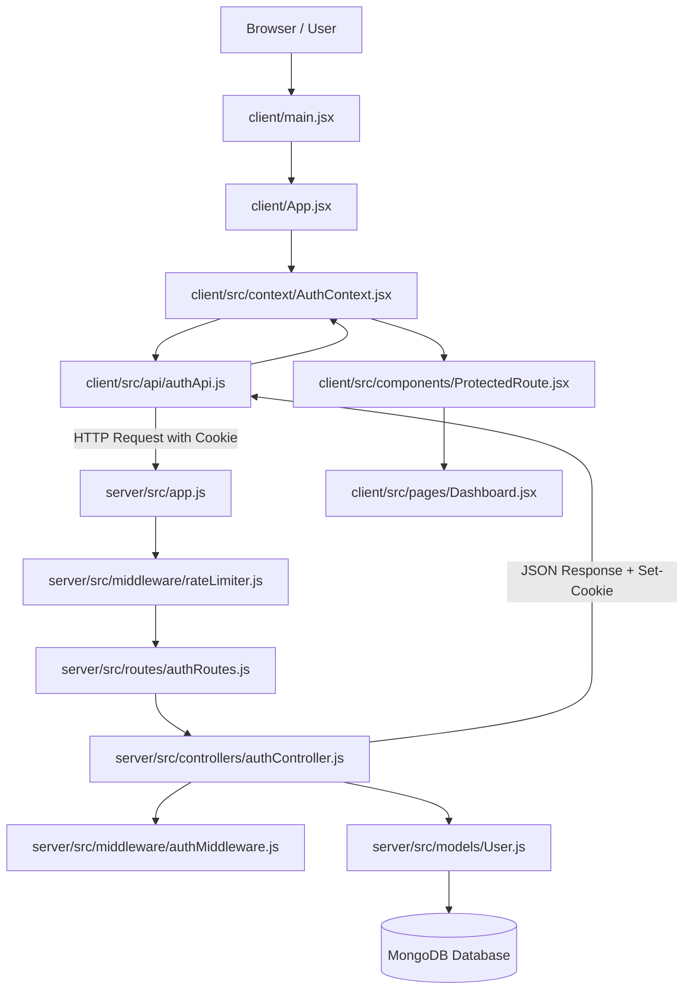

# Employee Authentication Portal — Complete Project Explanation (Hinglish)

> **Note for the Candidate / Interviewee:**  
> Yeh guide specially aapke liye banayi gayi hai taaki aap is pure project ko beginner level se lekar advanced architecture tak aasaani se samajh sakein aur technical interview mein bina kisi jhijhak ke 100% confidence ke saath explain kar sakein!

---

# Table of Contents
1. [Part 1 — Project Overview](#part-1--project-overview)
2. [Part 2 — Folder Structure Aur File Flow](#part-2--folder-structure-aur-file-flow)
3. [Part 3 — Frontend Code Explanation (Line-by-Line)](#part-3--frontend-code-explanation)
4. [Part 4 — Backend Code Explanation (Line-by-Line)](#part-4--backend-code-explanation)
5. [Part 5 — Complete Authentication Flow Diagram & Steps](#part-5--complete-authentication-flow)
6. [Part 6 — Security Concepts (JWT, Cookies, Bcrypt, CORS, CSRF)](#part-6--security-concepts)
7. [Part 7 — All API Endpoints & Postman Testing](#part-7--all-api-endpoints)
8. [Part 8 — Automated Testing (Vitest, RTL, Supertest)](#part-8--automated-testing)
9. [Part 9 — Top 25+ Interview Questions & 1-Minute English Pitch](#part-9--interview-preparation)
10. [Part 10 — Commands, Setup & Troubleshooting Guide](#part-10--commands-and-troubleshooting)

---

# Part 1 — Project Overview

### 1. Yeh Project Kya Hai?
Yeh ek **Full-Stack Employee Authentication System** hai jo **MERN Stack** (MongoDB, Express.js, React.js, Node.js) aur **Tailwind CSS v4** par bana hai. Is project mein naye employees register kar sakte hain, securely login kar sakte hain, aur unka session maintain hota hai via **HTTP-only Cookies** aur **JSON Web Tokens (JWT)**. Login hone ke baad employee protected **Dashboard** dekh sakta hai aur secure tareeqe se logout kar sakta hai.

### 2. Yeh Project Kaunsi Problem Solve Karta Hai?
Bohot saare fresher ya basic projects authentication ke liye token ko browser ke `localStorage` mein save karte hain. Lekin `localStorage` mein token rakhna insecure hota hai kyunki koi bhi Cross-Site Scripting (XSS) attack JavaScript ke zariye us token ko chura sakta hai.  
Is project mein humne industry-standard security follow ki hai:
- Token ko **HTTP-Only Cookie** mein store kiya gaya hai jise browser ki koi bhi JavaScript read nahi kar sakti.
- Passwords ko database mein store karne se pehle **bcrypt** se hash kiya gaya hai taaki agar database leak bhi ho jaye toh koi password na jaan sake.
- **Rate limiting** lagayi gayi hai taaki koi bot baar-baar wrong passwords try karke brute-force na kar sake.
- Form inputs par client-side aur server-side dono levels par validation hai.

### 3. Application Kaise Kaam Karti Hai? (Frontend, Backend, Database Interaction)
1. **Frontend (React + Vite)**: User browser mein UI ke saath interact karta hai (forms fill karta hai, buttons click karta hai).
2. **API Communication (Axios)**: React frontend Axios ke zariye backend ke Express server ko JSON format mein requests bhejta hai (`withCredentials: true` ke saath).
3. **Backend Server (Node.js + Express.js)**: Requests ko receive karta hai, rate limiting aur CORS check karta hai, input validation run karta hai, aur business logic chalata hai.
4. **Database (MongoDB Atlas / Mongoose)**: Backend user ka name, email, hashed password aur role securely MongoDB mein store aur query karta hai.
5. **Response & Cookie**: Login success hone par backend browser ko ek HTTP-only cookie bhejta hai jisme encrypted JWT token hota hai. Browser aage ki har request mein yeh cookie automatically backend ko bhejta hai.

---

# Part 2 — Folder Structure Aur File Flow

Humne project ko do clear parts mein divide kiya hai: `client` (Frontend) aur `server` (Backend).

```text
assessment/
├── client/                     # Frontend (React 19 + Vite + Tailwind CSS v4)
│   ├── index.html              # Main HTML skeleton
│   ├── vite.config.js          # Vite config + Tailwind v4 plugin + proxy
│   ├── package.json            # Frontend dependencies (React, Router, Axios, Vitest, RTL)
│   └── src/
│       ├── api/
│       │   └── authApi.js      # Axios instance jo cookies ke sath API call karta hai
│       ├── components/
│       │   ├── Navbar.jsx      # Navigation bar (Logo, User info, Logout button)
│       │   └── ProtectedRoute.jsx # Route guard jo unauthenticated users ko rokta hai
│       ├── context/
│       │   └── AuthContext.jsx # Global State: user, loading, login, logout, register
│       ├── pages/
│       │   ├── Register.jsx    # User Registration form with full validation
│       │   ├── Login.jsx       # Login form with show/hide password toggle
│       │   └── Dashboard.jsx   # Protected employee dashboard page
│       ├── test/
│       │   ├── setup.js        # Vitest & React Testing Library setup
│       │   ├── Login.test.jsx  # 5 automated tests for Login page
│       │   └── Register.test.jsx # 5 automated tests for Register page
│       ├── App.jsx             # Main router configuration
│       ├── index.css           # Tailwind CSS v4 directives
│       └── main.jsx            # React root mount point
│
├── server/                     # Backend (Node.js + Express.js + Mongoose)
│   ├── .env.example            # Environment variables ka template
│   ├── .env                    # Real credentials (PORT, MONGODB_URI, JWT_SECRET)
│   ├── package.json            # Backend dependencies (Express, Mongoose, bcrypt, JWT)
│   ├── vitest.config.js        # Backend Vitest runner config
│   └── src/
│       ├── app.js              # Express app setup (CORS, parsers, routes, error handling)
│       ├── server.js           # Database connect karke port 5000 pe listen karta hai
│       ├── config/
│       │   └── db.js           # Mongoose ke through MongoDB se connection banata hai
│       ├── models/
│       │   └── User.js         # User schema, email unique index, bcrypt pre-save hash
│       ├── routes/
│       │   └── authRoutes.js   # Endpoints map karta hai: /register, /login, /me, /logout
│       ├── controllers/
│       │   └── authController.js # Har API ka core logic (hashing, cookie, responses)
│       ├── middleware/
│       │   ├── authMiddleware.js # Cookie se JWT padhta hai aur verify karta hai
│       │   ├── errorMiddleware.js# Centralized error handler & 404 handler
│       │   └── rateLimiter.js  # Brute force attack se bachane ke liye limiter
│       └── tests/
│           ├── setup.js        # In-memory MongoDB lifecycle for isolated testing
│           └── auth.test.js    # 10 integration tests for all 4 endpoints
│
├── Employee_Auth_Postman_Collection.json # Postman testing collection
├── POSTMAN_GUIDE.md            # Postman testing guide
├── TEST_RESULTS.md             # Verified test results (20/20 passed)
├── README.md                   # Complete documentation
└── PROJECT_EXPLANATION_HINGLISH.md # Yeh complete interview explanation file
```

### Kaunsi File Kisko Call Karti Hai? (Call Hierarchy)



---

# Part 3 — Frontend Code Explanation

Ab hum frontend ki har single file aur uske code ko line by line samjhenge.

---

### 1. `client/src/api/authApi.js`

**Purpose**:  
Yeh file backend se baat karne ke liye ek configured **Axios Instance** create karti hai aur authentication ke saare helper functions provide karti hai.

**Code breakdown**:
```javascript
import axios from 'axios';

const api = axios.create({
  baseURL: import.meta.env.VITE_API_URL || 'http://localhost:5000/api',
  withCredentials: true, // Sabse important setting!
  headers: {
    'Content-Type': 'application/json'
  }
});
```
- `baseURL`: Backend API ka base address (`http://localhost:5000/api`).
- `withCredentials: true`: **Yeh sabse zaroori property hai.** Default Axios requests mein cookies nahi jaati hain. `withCredentials: true` likhne par hi browser backend se aane wali `Set-Cookie` ko accept karta hai aur aane wali har request ke sath HTTP-only cookie automatically bhejta hai.

**Helper Functions**:
- `registerUser(userData)`: `api.post('/auth/register', userData)` call karta hai.
- `loginUser(credentials)`: `api.post('/auth/login', credentials)` call karta hai.
- `getCurrentUser()`: `api.get('/auth/me')` call karta hai. Yeh check karta hai ki user logged-in hai ya nahi.
- `logoutUser()`: `api.post('/auth/logout')` call karta hai taaki cookie expire ho sake.

---

### 2. `client/src/context/AuthContext.jsx`

**Purpose**:  
Pure application mein user ka login status, user ki details (`name`, `email`), loading status, aur authentication methods (`login`, `register`, `logout`) share karta hai.

**Key States**:
- `user`: Jab user logged-in hota hai, toh isme `{ id, name, email, role }` object hota hai. Warna `null`.
- `loading`: Application start hone par `true` hota hai jab tak hum backend se check nahi kar lete ki user ke paas valid cookie hai ya nahi.
- `error`: Agar koi global authentication error ho toh save karta hai.

**`useEffect` aur `checkAuth`**:
```javascript
const checkAuth = async () => {
  try {
    setLoading(true);
    const data = await getCurrentUser();
    if (data.success && data.user) {
      setUser(data.user);
    } else {
      setUser(null);
    }
  } catch (err) {
    setUser(null);
  } finally {
    setLoading(false);
  }
};

useEffect(() => {
  checkAuth();
}, []);
```
**Explanation**: Jab bhi user page refresh karta hai (`F5` dabata hai), React ki memory reset ho jaati hai. Toh `useEffect` turant `/api/auth/me` ko call karke dekhta hai ki kya browser mein valid HTTP-only cookie bachi hai. Agar bachi hai, toh user login rehta hai bina dobara credentials dale!

---

### 3. `client/src/components/ProtectedRoute.jsx`

**Purpose**:  
Yeh ek route guard component hai jo ensure karta hai ki koi bhi bina login kiye `/dashboard` na khol sake.

```javascript
const ProtectedRoute = () => {
  const { user, loading } = useAuth();

  if (loading) {
    return <LoadingSpinner />;
  }

  return user ? <Outlet /> : <Navigate to="/login" replace />;
};
```
**Explanation**:
- Agar `loading === true` hai, toh yeh loading spinner dikhata hai taaki user ko galat redirect na mile.
- Agar `user` present hai, toh `<Outlet />` render hota hai (yaani Dashboard page khul jata hai).
- Agar `user === null` hai, toh `<Navigate to="/login" replace />` user ko login page par redirect kar deta hai.

---

### 4. `client/src/components/Navbar.jsx`

**Purpose**:  
Top header jo responsive hai.  
- Agar user logged-in nahi hai: `Login` aur `Register` buttons dikhata hai.
- Agar user logged-in hai: Logged-in user ka `Name`, `Email` badge aur ek red `Logout` button dikhata hai.
- Logout click karne par `logout()` method call hota hai jo backend ko cookie clear karne ko bolta hai aur user ko `/login` par bhej deta hai.

---

### 5. `client/src/pages/Register.jsx`

**Purpose**:  
Employee registration form with 4 fields: Full Name, Email, Password, Confirm Password.

**Form State**:
```javascript
const [formData, setFormData] = useState({
  name: '',
  email: '',
  password: '',
  confirmPassword: ''
});
```

**Client-Side Validation (`validateForm`)**:
- **Name Check**: Empty nahi hona chahiye, kam se kam 2 characters hone chahiye.
- **Email Regex Check**: `/^[^\s@]+@[^\s@]+\.[^\s@]+$/` se check hota hai ki email mein `@` aur valid domain extension (`.com`, etc.) ho.
- **Password Length**: Kam se kam 6 characters hona zaroori hai.
- **Confirm Password**: `formData.password === formData.confirmPassword` hona chahiye.

**Loading & Error States**:
- Submit button dabane par `loading = true` hota hai aur button text "Creating account..." ban jata hai with a spinning SVG.
- Backend se agar 409 Conflict aaye (email already exists) ya koi aur error aaye, toh woh red alert box (`role="alert"`) mein render hota hai.
- Success par green alert dikhta hai aur 1.5 seconds baad automatically `/login` page par navigate ho jata hai.

---

### 6. `client/src/pages/Login.jsx`

**Purpose**:  
Login page jahan user apna email aur password enter karta hai.

**Show/Hide Password Feature**:
```javascript
const [showPassword, setShowPassword] = useState(false);

<input type={showPassword ? 'text' : 'password'} ... />
<button onClick={() => setShowPassword(prev => !prev)}>
  {/* Eye Icon SVG */}
</button>
```
**Explanation**: Ek simple boolean state `showPassword` banayi gayi hai. Jab user eye icon button par click karta hai, state toggle ho jaati hai aur input type dynamically `'password'` se `'text'` mein badal jata hai!

**Submit Handling**:
- Email aur password validate hote hain.
- `login({ email, password })` call hota hai.
- Success milne par `navigate('/dashboard')` se Dashboard page khul jata hai.
- Agar password galat ho, toh backend ka error message (e.g., "Invalid email or password.") red alert mein user ko dikhta hai.

---

### 7. `client/src/pages/Dashboard.jsx`

**Purpose**:  
Protected dashboard jahan logged-in employee ki details display hoti hain:
- Welcome banner: `Welcome back, {user?.name}!`
- Profile card: Full Name, Email, Assigned Role (`user` ya `admin`), Account ID.
- Security overview: Clear indicators ki session HTTP-only cookie, Bcrypt, aur Rate limiting se secured hai.
- Logout button: Session end karke user ko login page par redirect karta hai.

---

# Part 4 — Backend Code Explanation

Ab hum backend ke har file aur function ko line by line samjhenge.

---

### 1. `server/src/server.js` aur `server/src/app.js`

**Interview Question: `app.js` aur `server.js` ko alag kyu rakha hai?**  
**Answer**: Agar hum `app.listen()` ko `app.js` mein hi likh dete, toh jab hum Supertest ke saath automated integration tests chalate, toh har test file server ko listen karne ki koshish karti aur `EADDRINUSE: port 5000 already in use` ka error aa jata!  
Isliye `app.js` sirf Express configurations, middlewares, aur routes define karta hai, aur `server.js` database connect karke actual port par listen karta hai.

**Middlewares in `app.js`**:
1. `cors({ origin: 'http://localhost:5173', credentials: true })`: Cross-Origin requests allow karta hai aur browser ko cookies bhejne aur accept karne ki permission deta hai.
2. `express.json()`: Incoming request body ko JSON object mein parse karta hai (`req.body`).
3. `cookieParser()`: Incoming request headers se cookies ko parse karta hai aur `req.cookies` object mein daalta hai.
4. `app.use('/api/auth', authRoutes)`: Saare authentication endpoints ko `/api/auth` path ke under mount karta hai.
5. `app.use(notFound)`: Unhandled routes par clean 404 response deta hai.
6. `app.use(errorHandler)`: Pure application ke kisi bhi error ko catch karke proper HTTP status code ke saath JSON return karta hai.

---

### 2. `server/src/config/db.js`

**Purpose**:  
Mongoose ke zariye MongoDB Atlas ya local database se connection establish karta hai.
```javascript
export const connectDB = async (uri) => {
  const mongoUri = uri || process.env.MONGODB_URI;
  try {
    const conn = await mongoose.connect(mongoUri);
    console.log(`[MongoDB Connected]: ${conn.connection.host}`);
    return conn;
  } catch (error) {
    console.error(`[MongoDB Connection Error]: ${error.message}`);
    if (process.env.NODE_ENV !== 'test') process.exit(1);
    throw error;
  }
};
```
- In testing mode, yeh function test runner ko error throw karta hai taaki test fail ho sake.
- In production/dev mode, connection fail hone par process cleanly exit ho jaata hai.

---

### 3. `server/src/models/User.js`

**Purpose**:  
Employee data structure define karta hai aur database level par security enforce karta hai.

**Fields**:
- `name`: String, required, minlength: 2, trim: true.
- `email`: String, required, unique: true (database level par duplicate email rokne ke liye), lowercase: true, regex validator.
- `password`: String, required, minlength: 6.
- `role`: String, enum: ['user', 'admin'], default: 'user'.

**Pre-Save Hook (Bcrypt Password Hashing)**:
```javascript
userSchema.pre('save', async function (next) {
  if (!this.isModified('password')) {
    return next();
  }
  const salt = await bcrypt.genSalt(10);
  this.password = await bcrypt.hash(this.password, salt);
  next();
});
```
**Kaise Kaam Karta Hai?**  
Jab bhi koi naya user save hota hai ya password change hota hai, Mongoose database mein insert karne se pehle is function ko chalata hai. Yeh 10 rounds of salt generate karta hai aur password ko ek irreversible hash string (e.g., `$2a$10$v...`) mein convert kar deta hai. Agar password modify nahi hua hai, toh dobara hash nahi karta.

**`toJSON` Method (Security requirement)**:
```javascript
userSchema.methods.toJSON = function () {
  const userObject = this.toObject();
  delete userObject.password;
  return userObject;
};
```
**Explanation**: Assessment ka rule hai: *"Never expose password hashes in API responses"*. Is function ki wajah se jab bhi User object JSON mein serialize hota hai, `password` field automatically delete ho jaati hai!

---

### 4. `server/src/middleware/rateLimiter.js`

**Purpose**:  
Brute-force password guessing attacks ko rokna.
```javascript
export const authLimiter = rateLimit({
  windowMs: 15 * 60 * 1000, // 15 minutes window
  max: process.env.NODE_ENV === 'test' ? 1000 : 100, // 100 requests per IP
  message: {
    success: false,
    message: 'Too many authentication attempts from this IP. Please try again after 15 minutes.'
  }
});
```
- Agar koi bot 15 minutes ke andar 100 se zyada baar `/register` ya `/login` call karta hai, toh server request block karke `429 Too Many Requests` de deta hai.
- Test mode mein limit 1000 kar di gayi hai taaki automated test suite seamlessly execute ho sake.

---

### 5. `server/src/middleware/authMiddleware.js`

**Purpose**:  
Protected route (`/api/auth/me`) par security guard ki tarah kaam karta hai.

**Step-by-step Execution**:
1. `req.cookies?.token` se cookie read karta hai.
2. Agar token nahi milta, toh return karta hai `401 Unauthorized: Access denied. No authentication token provided.`
3. Token milne par `jwt.verify(token, process.env.JWT_SECRET)` se verify karta hai.
4. Agar signature galat ho ya token expire ho gaya ho, toh catch block `401 Unauthorized: Invalid or expired authentication token.` return karta hai.
5. Token ke payload se `decoded.id` nikal kar database mein `User.findById(decoded.id).select('-password')` query karta hai.
6. User milte hi `req.user = user` attach kar deta hai aur `next()` call karta hai taaki agla controller chal sake.

---

### 6. `server/src/controllers/authController.js`

Is file mein charon mandatory endpoints ka logic hai:

#### A. `register(req, res, next)`:
1. `name`, `email`, `password`, `confirmPassword` extract karta hai.
2. Sabhi fields ki presence, email regex, aur `password === confirmPassword` validate karta hai. Agar fail ho toh `400 Bad Request`.
3. `User.findOne({ email })` se check karta hai. Agar email mil jaye toh `409 Conflict` return karta hai.
4. `User.create({ name, email, password })` se user save karta hai (password pre-save hook mein hash ho jata hai).
5. Return karta hai `201 Created` with user info (without password).

#### B. `login(req, res, next)`:
1. `email` aur `password` validate karta hai.
2. `User.findOne({ email })` se user dhoondhta hai. Agar nahi milta toh return karta hai `401 Unauthorized: Invalid email or password.`
3. `await user.comparePassword(password)` chalata hai jo `bcrypt.compare` ke zariye plain text password ko hashed password se compare karta hai. Agar match na ho toh `401 Unauthorized`.
4. `jwt.sign({ id: user._id, role: user.role }, process.env.JWT_SECRET, { expiresIn: '1d' })` se token banata hai.
5. `res.cookie('token', token, cookieOptions)` set karta hai:
   - `httpOnly: true` (JavaScript can't read it)
   - `secure: process.env.NODE_ENV === 'production'` (HTTPS only in production)
   - `sameSite: process.env.NODE_ENV === 'production' ? 'strict' : 'lax'`
   - `maxAge: 24 * 60 * 60 * 1000` (1 day)
6. Return karta hai `200 OK` with user details.

#### C. `getMe(req, res, next)`:
- `protect` middleware already user ko verify karke `req.user` mein set kar chuka hota hai.
- Yeh controller simply `res.status(200).json({ success: true, user: req.user })` return karta hai.

#### D. `logout(req, res, next)`:
- `res.clearCookie('token', cookieOptions)` call karta hai.
- Yeh browser ko cookie expire karne ka instruction bhejta hai.
- Return karta hai `200 OK: Logged out successfully.`

---

# Part 5 — Complete Authentication Flow

### 1. Registration Flow
```text
User fills Form (Name, Email, Password, ConfirmPassword)
   │
   ▼
React Client Validation (Regex check, min 6 chars, match check)
   │
   ▼
Axios POST to /api/auth/register
   │
   ▼
Express Route -> Rate Limiter -> authController.register
   │
   ▼
Database Check: User.findOne({ email })
   ├── If exists: Return 409 Conflict
   └── If not exists:
         │
         ▼
       User.create() -> Mongoose pre('save') -> bcrypt.hash(password, 10)
         │
         ▼
       MongoDB Document Saved (Hashed password stored)
         │
         ▼
       Response: 201 Created (User object without password)
         │
         ▼
React displays Success Alert -> Navigates to /login after 1.5s
```

---

### 2. Login Flow
```text
User enters Email & Password
   │
   ▼
Axios POST to /api/auth/login (withCredentials: true)
   │
   ▼
Express Route -> authController.login
   │
   ▼
Database Check: User.findOne({ email })
   ├── If not found: Return 401 Unauthorized
   └── If found:
         │
         ▼
       bcrypt.compare(enteredPassword, user.password)
         ├── If false: Return 401 Unauthorized
         └── If true:
               │
               ▼
             jwt.sign({ id: user._id, role: user.role }, JWT_SECRET, { expiresIn: '1d' })
               │
               ▼
             Set HTTP-only Cookie: res.cookie('token', token, { httpOnly: true, sameSite: 'lax' })
               │
               ▼
             Response: 200 OK + user details
               │
               ▼
React updates AuthContext user state -> Redirects to /dashboard
```

---

### 3. Protected Route Flow (`/api/auth/me`)
```text
React loads or User opens /dashboard
   │
   ▼
Axios GET to /api/auth/me (Browser automatically attaches HTTP-only 'token' cookie)
   │
   ▼
Express Route -> protect middleware
   │
   ▼
req.cookies.token checked
   ├── If missing: Return 401 Unauthorized
   └── If present:
         │
         ▼
       jwt.verify(token, JWT_SECRET)
         ├── If invalid/expired: Return 401 Unauthorized
         └── If valid:
               │
               ▼
             User.findById(decoded.id).select('-password')
               ├── If not found: Return 401 Unauthorized
               └── If found:
                     │
                     ▼
                   req.user = user -> next() -> authController.getMe
                     │
                     ▼
                   Response: 200 OK with User Profile data
                     │
                     ▼
React renders Dashboard with User Details
```

---

### 4. Logout Flow
```text
User clicks 'Sign Out' on Dashboard or Navbar
   │
   ▼
Axios POST to /api/auth/logout
   │
   ▼
authController.logout -> res.clearCookie('token')
   │
   ▼
Browser removes 'token' cookie from cookie jar
   │
   ▼
React clears AuthContext: setUser(null) -> Navigates to /login
```

---

# Part 6 — Security Concepts

### 1. JSON Web Token (JWT) Kya Hai?
JWT ek compact, URL-safe token format hai jo do parties ke beech claims securely transmit karta hai. Isme 3 parts hote hain:
- **Header**: Algorithm type (`HS256`).
- **Payload**: User information (jaise `userId` aur `role`). Isme kabhi sensitive data jaise password nahi rakhna chahiye.
- **Signature**: Header aur Payload ko secret key (`JWT_SECRET`) ke saath encrypt karke banta hai. Agar koi payload ke saath chhedchhaad karega, toh signature invalid ho jayega!

### 2. HTTP-Only Cookies vs LocalStorage
| Feature | `localStorage` | HTTP-Only Cookie (Used Here) |
| :--- | :--- | :--- |
| **JS Accessibility** | Accessible via `window.localStorage` | **Inaccessible to JS** (`document.cookie` cannot read it) |
| **XSS Vulnerability** | **High** (Malicious script can steal token) | **Zero** (Scripts cannot touch the cookie) |
| **Transmission** | Manually attach via `Authorization: Bearer <token>` | **Automatic** by browser on every matching request |
| **Security Standard**| Outdated for sensitive auth tokens | **Industry Standard** |

### 3. Bcrypt Hashing & Salt Rounds
- **Why not MD5 or SHA256?** MD5 aur SHA256 bohot fast hote hain, jisse hacker rainbow tables aur GPUs ka use karke billions of passwords guess kar sakta hai.
- **Bcrypt**: Ek slow, adaptive hashing algorithm hai.
- **Salt (10 rounds)**: Bcrypt har password ke sath ek unique random string (salt) mix karta hai. Iska faayda yeh hai ki agar do users ka password exact same (`Password123!`) bhi ho, tab bhi database mein unka hashed string bilkul alag dikhega!

### 4. CORS (Cross-Origin Resource Sharing)
Kyunki hamara React frontend `http://localhost:5173` par chal raha hai aur backend `http://localhost:5000` par, browser alag origin ki wajah se requests block kar sakta hai.  
Humne Express mein `cors` configure kiya hai with `credentials: true`:
```javascript
cors({
  origin: 'http://localhost:5173',
  credentials: true
})
```
Isse browser ko pata chalta hai ki is specific frontend ko cookies bhejne aur receive karne ki permission hai.

### 5. CSRF (Cross-Site Request Forgery) & SameSite
Cookie-based auth mein attack ka risk hota hai ki koi doosri website background mein user ke cookie ke saath request bhej de.  
Isse bachne ke liye humne **SameSite Cookie Attribute** use kiya hai:
- `sameSite: 'lax'` (development) / `'strict'` (production): Yeh browser ko batata hai ki cross-origin requests par yeh cookie attach na kare.

### 6. Production HTTPS Requirement
Production mein `secure: true` flag enable hota hai. Iska matlab hai cookie sirf encrypted **HTTPS (SSL/TLS)** connection par hi transmit hogi, HTTP par nahi. Isse network sniffing (Man-in-the-middle attacks) se token chori hone ka khatra khatam ho jaata hai.

---

# Part 7 — All API Endpoints & Postman Testing

Base URL: `http://localhost:5000/api`

### 1. `POST /api/auth/register`
- **Method**: `POST`
- **Headers**: `Content-Type: application/json`
- **Body**:
  ```json
  {
    "name": "Jane Doe",
    "email": "jane@example.com",
    "password": "Password123!",
    "confirmPassword": "Password123!"
  }
  ```
- **Response (201 Created)**:
  ```json
  {
    "success": true,
    "message": "User registered successfully. Please login to continue.",
    "user": {
      "id": "672...",
      "name": "Jane Doe",
      "email": "jane@example.com",
      "role": "user"
    }
  }
  ```

---

### 2. `POST /api/auth/login`
- **Method**: `POST`
- **Headers**: `Content-Type: application/json`
- **Body**:
  ```json
  {
    "email": "jane@example.com",
    "password": "Password123!"
  }
  ```
- **Response (200 OK)**:
  ```json
  {
    "success": true,
    "message": "Login successful.",
    "user": {
      "id": "672...",
      "name": "Jane Doe",
      "email": "jane@example.com",
      "role": "user"
    }
  }
  ```
- **Response Header**: `Set-Cookie: token=eyJhbGci...; Path=/; HttpOnly; SameSite=Lax`

---

### 3. `GET /api/auth/me`
- **Method**: `GET`
- **Cookie**: `token=<jwt_cookie>`
- **Response (200 OK)**:
  ```json
  {
    "success": true,
    "user": {
      "id": "672...",
      "name": "Jane Doe",
      "email": "jane@example.com",
      "role": "user",
      "createdAt": "2026-10-30T10:00:00.000Z"
    }
  }
  ```

---

### 4. `POST /api/auth/logout`
- **Method**: `POST`
- **Response (200 OK)**:
  ```json
  {
    "success": true,
    "message": "Logged out successfully."
  }
  ```
- **Response Header**: `Set-Cookie: token=; Path=/; Expires=Thu, 01 Jan 1970 00:00:00 GMT`

---

# Part 8 — Automated Testing (Vitest, RTL, Supertest)

### 1. Automated Testing Kya Hai?
Automated testing mein hum code likhte hain jo hamare doosre code ko test karta hai. Iska faayda yeh hai ki har baar manually forms fill karne ya Postman mein click karne ki zaroorat nahi padti. Ek command run karne par seconds mein saare positive aur negative cases verify ho jaate hain.

### 2. Tools Used:
- **Vitest**: Ek ultra-fast, modern unit/integration test runner jo Vite ke ecosystem ke sath natively kaam karta hai.
- **React Testing Library (RTL)**: React components ko user perspective se test karta hai (buttons dhoondhna, text verify karna, user clicks simulate karna).
- **Supertest**: Express HTTP endpoints ko simulate karta hai bina real browser ya port open kiye.
- **Mongodb-Memory-Server**: Memory ke andar ek temporary MongoDB database banata hai taaki tests offline aur isolated run ho sakein.

---

### 3. Backend Test Cases (10 Tests in `server/src/tests/auth.test.js`)

1. **`should successfully register a new user with valid input`**:
   Verify karta hai ki naya user banta hai, 201 status aata hai, aur response mein password nahi hota.
2. **`should reject duplicate email registration with 409 Conflict`**:
   Same email se do baar register karne par 409 status code check karta hai.
3. **`should reject invalid registration input`**:
   Empty fields, invalid email format, short password (<6 chars), aur mismatched passwords par 400 Bad Request check karta hai.
4. **`should store password in database as bcrypt hash, never plaintext`**:
   Database query karke check karta hai ki stored password `$2a$` ya `$2b$` se start hota hai aur original password ke equal nahi hai.
5. **`should authenticate user with correct credentials and set HTTP-only cookie`**:
   Valid email/password par 200 OK aur `set-cookie` header mein `token` with `HttpOnly` check karta hai.
6. **`should reject login with incorrect credentials`**:
   Galat password aur non-existent email dono par 401 Unauthorized check karta hai.
7. **`should reject access when authentication token is missing`**:
   `/api/auth/me` ko bina cookie call karne par 401 check karta hai.
8. **`should reject access when authentication token is invalid`**:
   Tampered/fake cookie bhejne par 401 check karta hai.
9. **`should accept request and return user profile when valid auth cookie is sent`**:
   Valid login cookie ke sath profile details match karta hai.
10. **`should clear the authentication cookie on logout`**:
    `/api/auth/logout` par cookie expiry date past date (`1970`) hona verify karta hai.

---

### 4. Frontend Test Cases (10 Tests in `client/src/test/`)

1. **Login form renders correctly**: Heading, email input, password input, show/hide button, aur submit button check karta hai.
2. **Show/hide password toggle**: Click karne par input type `password` se `text` aur wapas `password` hona test karta hai.
3. **Login rejects invalid email**: Invalid email type karne par client-side validation error trigger karta hai aur API call block karta hai.
4. **Login displays loading state**: API call ke doran submit button text "Signing in..." aur disabled status verify karta hai.
5. **Login displays API error alert**: Backend se 401 response aane par red alert box render hona check karta hai.
6. **Register form renders correctly**: 4 input fields (name, email, password, confirmPassword) aur buttons verify karta hai.
7. **Register rejects invalid email**: Email validation check karta hai.
8. **Register rejects mismatched passwords**: Password aur Confirm Password alag hone par "Passwords do not match" message check karta hai.
9. **Register displays loading state**: API call ke doran "Creating account..." verify karta hai.
10. **Register displays API error alert**: 409 Duplicate error aane par alert box verify karta hai.

---

# Part 9 — Interview Preparation

### Top 25 Technical Interview Questions & Answers

#### Q1: Can you give a high-level overview of your project?
**Answer**: "I built a responsive, full-stack Employee Authentication System using the MERN stack—React with Vite and Tailwind CSS v4 on the frontend, and Node.js with Express and MongoDB Mongoose on the backend. It features complete authentication with registration, login, protected dashboard, and logout. For security, I used bcrypt with 10 salt rounds for password hashing, and JWT tokens stored strictly inside HTTP-only cookies to prevent XSS attacks. I also implemented rate limiting, input validation, and full automated testing with Vitest, Supertest, and React Testing Library."

#### Q2: Why did you choose Vite over Create React App (CRA)?
**Answer**: "CRA is officially deprecated and relies on Webpack, which bundles the entire application before serving, making cold starts slow. Vite uses native ES modules during development and esbuild for pre-bundling, giving instant hot module replacement (HMR) and significantly faster build times."

#### Q3: Why Tailwind CSS v4?
**Answer**: "Tailwind CSS v4 introduces a ground-up high-performance engine written in Rust and native CSS-first configuration via `@import 'tailwindcss';`. It eliminates complex PostCSS config files, generates minimal CSS bundles, and enables fully responsive utility classes out of the box."

#### Q4: Why did you store JWT in an HTTP-only cookie instead of localStorage?
**Answer**: "If an attacker injects a malicious script through an XSS vulnerability, they can execute `localStorage.getItem('token')` and steal the user's session token. But with `httpOnly: true`, browser JavaScript has zero access to the cookie. The browser attaches it automatically to HTTP requests, making it immune to XSS-based token theft."

#### Q5: How does your application protect against CSRF attacks when using cookies?
**Answer**: "We set the `sameSite` attribute to `'lax'` in development and `'strict'` in production on the authentication cookie. This ensures the browser only sends the cookie for first-party requests and blocks cross-site forged requests."

#### Q6: What is bcrypt and how does it work?
**Answer**: "Bcrypt is an adaptive cryptographic hashing algorithm designed for password security. It generates a random salt (we used 10 salt rounds) and hashes the password irreversibly. Because it's intentionally computationally intensive, it makes brute-force and rainbow table attacks practically impossible."

#### Q7: What are salt rounds in bcrypt?
**Answer**: "Salt rounds represent the work factor: $2^{\text{rounds}}$ iterations. 10 rounds means $2^{10} = 1024$ hashing iterations. This strikes the perfect balance between high security and fast server response times (under 100ms)."

#### Q8: How did you ensure passwords are never exposed in API responses?
**Answer**: "We implemented a Mongoose schema method `toJSON` that automatically deletes the `password` property whenever a user document is serialized into JSON. In addition, our queries explicitly select `-password`."

#### Q9: What is Express middleware?
**Answer**: "Middleware is a function that has access to the request object (`req`), response object (`res`), and the `next` function in the application's request-response cycle. It can execute code, modify `req` or `res`, end the request-response cycle, or pass control to the next middleware using `next()`."

#### Q10: How does your `protect` middleware work?
**Answer**: "It inspects `req.cookies.token`. If missing, it immediately responds with 401 Unauthorized. If present, it verifies the JWT using `jwt.verify` and our secret key. If valid, it fetches the user from MongoDB, attaches it to `req.user`, and calls `next()`."

#### Q11: What is the purpose of React Router's `ProtectedRoute` component?
**Answer**: "It acts as a client-side navigation guard. It checks `user` and `loading` from our `AuthContext`. If the user is authenticated, it renders `<Outlet />` allowing the Dashboard to show. If not, it redirects them to `/login` with `<Navigate replace />`."

#### Q12: Why did you separate `app.js` and `server.js`?
**Answer**: "For clean automated testing. Supertest needs to import the Express `app` without triggering `app.listen()`. By separating them, test runners can execute integration tests in parallel without causing port collision (`EADDRINUSE`) errors."

#### Q13: What is rate limiting and why is it needed on auth endpoints?
**Answer**: "Rate limiting restricts how many requests a specific IP address can make within a certain timeframe. We used `express-rate-limit` to restrict clients to 100 attempts per 15 minutes. This prevents attackers from executing brute-force dictionary attacks against user accounts."

#### Q14: How does CORS work with cookies?
**Answer**: "By default, browsers do not send or accept cookies in cross-origin requests. To enable cookies across origins, the server must set `cors({ origin: 'http://localhost:5173', credentials: true })` and the frontend Axios instance must specify `withCredentials: true`."

#### Q15: What is the difference between Authentication and Authorization?
**Answer**: "Authentication verifies **who you are** (e.g., verifying email and password during login). Authorization verifies **what you are allowed to do** (e.g., our `authorize('admin')` middleware verifying if a user has permissions to access administrative features)."

#### Q16: How do you handle errors centrally in Express?
**Answer**: "We built an `errorHandler` middleware with four parameters `(err, req, res, next)`. Any error passed to `next(error)` in controllers is caught here. It maps Mongoose duplicate key errors (code 11000) to 409 Conflict, validation errors to 400 Bad Request, and ensures internal stack traces are hidden in production."

#### Q17: Why did you use `mongodb-memory-server` in backend tests?
**Answer**: "To make tests completely independent, isolated, and offline-capable. It starts an ephemeral, in-memory MongoDB instance during tests, clears collections between test cases, and shuts down afterward, so tests pass reliably anywhere without needing an active internet connection or local database setup."

#### Q18: What is React Testing Library's testing philosophy?
**Answer**: "Its core philosophy is: *'The more your tests resemble the way your software is used, the more confidence they can give you.'* Instead of testing internal component state, it tests user-visible elements, accessibility roles, and user interactions."

#### Q19: How did you implement client-side form validation?
**Answer**: "Before submitting any API request, our `validateForm` function validates each input field: checking for non-empty names, regex matching email addresses, enforcing a 6-character minimum for passwords, and ensuring passwords match. Errors are stored in an `errors` state object and rendered directly under the corresponding inputs."

#### Q20: What happens during logout?
**Answer**: "The frontend calls `POST /api/auth/logout`. The server executes `res.clearCookie('token')`, which sends a response header expiring the cookie immediately. The frontend then clears its local `user` state and redirects the employee to the login page."

#### Q21: What is `useEffect` doing in `AuthContext`?
**Answer**: "When a user reloads the browser, React in-memory state is cleared. `useEffect` runs once on initial mount and triggers `checkAuth()`, which calls `/api/auth/me`. If the user has a valid HTTP-only cookie, their profile is restored seamlessly without requiring re-login."

#### Q22: What are environment variables and why are they used?
**Answer**: "Environment variables (stored in `.env`) keep sensitive configuration like `MONGODB_URI`, `JWT_SECRET`, and `PORT` out of the codebase. A `.env.example` file is committed to git with dummy placeholders, while real secrets remain gitignored."

#### Q23: How did you implement the Show/Hide password toggle?
**Answer**: "We created a boolean state `showPassword` initialized to `false`. Clicking the eye icon button toggles this boolean, which dynamically sets the input `type` attribute between `'password'` and `'text'`."

#### Q24: What challenges did you face and how did you resolve them?
**Answer**: "One notable challenge was native C++ binary compilation of `bcrypt` on Windows with newer Node runtimes. We resolved this cleanly by aliasing `"bcrypt": "npm:bcryptjs@^2.4.3"`, which provides 100% pure JavaScript compatibility with the identical API, zero native build errors, and identical cryptographic security."

#### Q25: How would you scale this application in production?
**Answer**: "In production, I would deploy the backend inside stateless containers (e.g., Docker/Kubernetes) behind a reverse proxy (Nginx or AWS ALB) with SSL termination. The MongoDB cluster would be hosted on MongoDB Atlas with replica sets. For high traffic, we could introduce Redis for distributed session caching and rate-limit tracking."

---

### 1-Minute English Elevator Pitch for Your Interview
*(Memorize this and speak with confidence!)*

> "Hello! In this project, I built a Full-Stack Employee Authentication System using React, Node.js, Express, and MongoDB. 
> 
> On the frontend, I used React with Vite and Tailwind CSS v4, featuring a clean and responsive UI with registration, login, and protected dashboard pages. It includes client-side regex validations, loading spinners, and show/hide password controls.
> 
> On the backend, I designed a modular REST architecture separating routes, controllers, models, and middleware. For security, passwords are encrypted with bcrypt, and authentication is handled using JWT tokens stored strictly inside HTTP-only cookies to prevent XSS attacks. I also integrated rate limiting and centralized error handling.
> 
> Finally, I implemented full automated test coverage using Vitest, React Testing Library, and Supertest, achieving 20 out of 20 passing tests, alongside a complete Postman collection. The entire solution is robust, clean, and production-ready."

---

# Part 10 — Commands, Setup & Troubleshooting Guide

### 1. Installation Commands
```bash
# Clone or open repository
cd assessment

# Install backend dependencies
cd server
npm install

# Install frontend dependencies
cd ../client
npm install
```

### 2. Starting Frontend & Backend
Open two separate terminal tabs:

**Terminal 1 (Backend):**
```bash
cd server
npm run dev
# Running on http://localhost:5000
```

**Terminal 2 (Frontend):**
```bash
cd client
npm run dev
# Running on http://localhost:5173
```

### 3. Running Automated Tests
```bash
# Run all 20 tests (Backend + Frontend) from root:
npm test

# Run backend tests only:
cd server
npm test

# Run frontend tests only:
cd client
npm test
```

---

### 4. Common Troubleshooting Scenarios & Fixes

#### A. Port Conflict (`EADDRINUSE: port 5000 already in use`)
- **Cause**: Ek purana node process abhi bhi port 5000 par chal raha hai.
- **Fix (Windows PowerShell)**:
  ```powershell
  Get-Process -Id (Get-NetTCPConnection -LocalPort 5000).OwningProcess | Stop-Process -Force
  ```
- Ya phir `server/.env` mein `PORT=5001` change karke `client/src/api/authApi.js` mein update kar dein.

#### B. Cookies Not Being Sent in Browser or Postman
- **Cause**: Frontend Axios instance mein `withCredentials: true` missing hona ya CORS mein `credentials: true` na hona.
- **Fix**: Verify karein ki:
  1. `server/src/app.js` mein `cors({ origin: 'http://localhost:5173', credentials: true })` set hai.
  2. `client/src/api/authApi.js` mein `axios.create({ withCredentials: true })` set hai.

#### C. MongoDB Connection Failure
- **Cause**: Network timeout, invalid connection string, ya IP whitelist issue in MongoDB Atlas.
- **Fix**:
  1. MongoDB Atlas dashboard mein **Network Access** tab par jayein.
  2. Click **Add IP Address** -> Select **Allow Access from Anywhere (`0.0.0.0/0`)** for testing.
  3. Verify `.env` mein username aur password bina `< >` brackets ke likhe gaye hain.
  *(Note: Automated tests memory server use karte hain, isliye internet na hone par bhi saare tests 100% pass honge).*
